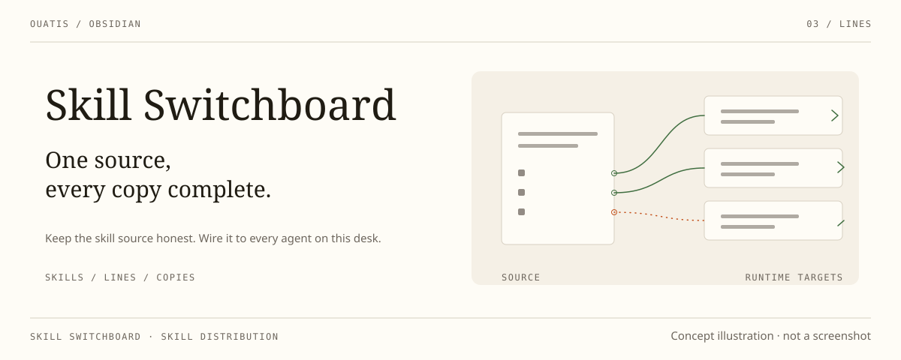

# Skill Switchboard

_Maintain skills in Obsidian. Distribute complete local copies._

[简体中文](./README.zh-CN.md)

  
  
  

Skill Switchboard is an Obsidian desktop plugin for maintaining one canonical skill source in your synced vault and distributing complete local packages to this computer's agents. Your existing vault sync moves the source between computers; Switchboard handles local files only — no cloud service, no network requests, and no telemetry. All reads and writes stay inside configured folders (your skill source, agent target folders, `<plugin>/snapshots/`, and `.skill-switchboard-status.json` at vault root).

Open the view from the ribbon icon or **Open switchboard** (docks in the main area or sidebar); settings live under **Settings → Community plugins → Skill Switchboard**. The interface follows your Obsidian theme and supports English and Simplified Chinese.

## Install

Available in the Obsidian community plugin store: enable community plugins, then **Settings → Community plugins → Browse** and search for **Skill Switchboard** (Obsidian 1.7.2 or newer on desktop).

Manual install: download `main.js`, `manifest.json`, and `styles.css` from the [releases page](https://github.com/ouatis/obsidian-skill-switchboard/releases), place them in `<vault>/.obsidian/plugins/skill-switchboard/`, and enable the plugin.

## Quick start

1. Keep standard `<skill>/SKILL.md` directories (containing `name`, `description`, and any `references/`, `scripts/`, or `assets/`) inside a vault folder such as `skills/` — no manifest required. Already have skills in local agent directories? Run **Import skills from local agents** (or **Import local skills** in settings or the empty library view) to copy selected packages into the source once without overwriting existing files.
2. Select that folder under **Distribution source** on each computer.
3. Add local targets under **Runtime targets** (or click **Detect existing targets**). Built-in support covers Claude Code, Codex, Cursor, Gemini CLI, Hermes, WorkBuddy, OpenCode, Antigravity, current DSH directory packages, and **Custom (standard `SKILL.md`)** for any off-vault folder (such as `~/.agents/skills` or project folders like `~/code/my-app/.claude/skills`). Use **Filter skills** on any target to include or exclude specific skills per destination without writing a manifest.
4. Run **Check skills** (read-only; differing copies include an expandable preview of changed files and `SKILL.md` line diffs), then **Repair all** after one confirmation.

## How distribution stays safe

- **One-way complete copies**: Installs the full `SKILL.md` body and required local files (preserving existing `agents/openai.yaml` for Codex). Local agent edits never write back to Obsidian, and unlisted skills stay untouched. Copying files does not install runtimes or dependencies, change permissions, or prove an active session loaded a skill.
- **Snapshots before overwrite or removal**: Every displaced or retired tree is copied to `<plugin>/snapshots/` first (keeping the 5 newest per skill); **Restore the latest skill snapshot** restores the latest copy after confirmation.
- **Retiring removed skills**: When a skill leaves the source (or is excluded by a target filter), **Retire copies whose source is gone** (and confirmed **Repair all**) removes unchanged copies tracked in the install ledger after snapshotting each one. Copies edited locally or written by hand are reported and kept.
- **Optional automatic distribution**: Off by default; authorized once per computer. Waits for a two-second quiet window and a second matching source snapshot before updating, never retires copies automatically, and revokes consent whenever the source, manifest, enabled targets, resolved paths, or skill filters change.
- **Atomic swaps and strict boundaries**: Each package is staged and verified beside its destination before swapping, restoring the displaced copy if a swap fails. Targets must stay outside the vault and cannot overlap the source; symlinks and missing resources block only the affected skill without hiding partial failures.

## Advanced: manifests, external packages & local state

- **Optional `skills-manifest.json`**: Still supported for legacy Markdown cards (`shared_file`, relative local reference closures, and `package_path` bundles) and per-runtime adapter metadata. Obsidian `[[wikilinks]]` remain vault context and are not copied into packages; an explicitly configured missing manifest fails rather than falling back.
- **External `package_id` toolkits**: Mapped per computer in `~/.skill-switchboard/packages.json` with optional schema-v1 SHA-256 inventory verification; never copied into agent folders or synced by Obsidian Sync.
- **Machine-local wiring & status**: Sources, targets, per-target skill filters, and automation consent are stored locally per vault checkout in `~/.skill-switchboard/vaults/<vault-id>/settings.json` (only UI preferences sync). `.skill-switchboard-status.json` at vault root records local check/repair diagnostics; review it for local paths before sharing.

Created by [@ouatis](https://github.com/ouatis).
