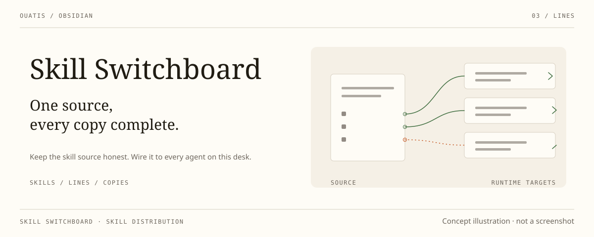

<div align="center">

# Skill Switchboard

_Maintain skills in Obsidian. Distribute complete local copies._

[简体中文](./README.zh-CN.md)

<p>
  
  
  
</p>

</div>



An Obsidian desktop plugin for keeping one canonical skill source in a synced
vault and distributing complete packages to this computer's agents. Your existing
vault sync carries the source between computers; Switchboard handles local files.
It provides no cloud service, makes no network requests and collects no telemetry.
All reads and writes stay inside the folders you configure — the skill source in
your vault, your agent target folders, and the plugin's own folder for snapshots
and status; nothing else on disk is touched.

Quiet panels and thin rules share a visual rhythm with Desk Lamp, Scriptorium
and Collate. The interface follows your Obsidian theme. English and Simplified
Chinese are available.

## Install

Requires Obsidian 1.7.2 or newer on desktop. For a published version, download
`main.js`, `manifest.json` and `styles.css` from the
[releases page](https://github.com/ouatis/obsidian-skill-switchboard/releases),
place them in `<vault>/.obsidian/plugins/skill-switchboard/`, then enable the plugin.
For unpublished changes, build from source using the Development steps below.

## One source, complete installations

1. Keep skills in a visible vault folder, normally `skills/`. Each standard skill
   is a directory with a `SKILL.md` containing `name` and `description`, plus its
   required references, scripts and assets. Standard directories are discovered
   without a hand-written manifest.
2. Sync the source with your existing vault sync arrangement. Select it under
   **Distribution source** on each computer.
3. Add the local agents you use under **Runtime targets**. Paths such as
   `~/.codex/skills` resolve on this computer. Targets must stay outside the vault
   and must not overlap the source.
4. Run **Check skills**, then **Repair all**. Missing packages are installed and
   differing copies are replaced from the source after one confirmation. Checks
   are read-only. Background writes require the separate local opt-in below.

The installed `SKILL.md` contains the instructions themselves, not a thin wrapper
that asks the model to read the real instructions elsewhere. Required files are
copied with the package. Runtime-specific metadata is added where needed; existing
`agents/openai.yaml` in a standard source package is preserved.

Codex, Hermes, WorkBuddy, OpenCode, Antigravity and current DSH directory packages
are supported. Copying files does not install runtimes, dependencies or commands,
change an agent's permissions, or prove that a running session loaded a skill.

## The source is authoritative

### Optional automatic distribution

**Automatic distribution** is off by default. Enable it in settings and approve
the displayed source and Agent folders once on this computer. This write grant
is stored only in the machine-local vault settings, never in synced preferences.
Changing the selected source, manifest, enabled targets, or resolved paths revokes
the grant; enabling it again requires a new confirmation. Overlapping Agent roots
cannot be authorized.

While Obsidian is running, background checks wait for a two-second quiet window
and a second matching source snapshot before distributing. A manual **Check skills**
remains read-only. Missing or unsafe resources block that skill; independent healthy
packages still update. The quiet window reduces partial-sync risk; it is not proof
that another machine finished syncing or that an Agent loaded a skill.

Transient filesystem refusals get at most three attempts (150/450 ms delays).
Successful runs update the board quietly. An unchanged persistent failure alerts
once per plugin session and is not retried every five minutes without a changed
source/target state; use **Repair all** for an explicit retry. Closing Obsidian,
disabling automation, changing its scope, or unloading the plugin cancels queued
work and prevents subsequent package swaps. The source-authority and no-history-
backup rules below apply to automatic runs too.

The **Distribution plan** shows four states per agent: **Not installed**,
**Replace from source**, **Matches source**, and **Blocked**. Blockers expand first
and show their reasons without requiring the raw log. Counts describe agent copies,
not unique source skills. One **Repair all** confirmation lists every install and
overwrite, with names and paths.

- A same-name target package is a disposable output of the selected source. Local
  edits and older installations are overwritten, not merged or kept as conflicts.
  There is no second takeover workflow or ownership database; checks compare the
  complete expected package directly against the actual files and executable modes.
- **No history backups are created.** Discarded local edits cannot be recovered
  through this plugin after a successful overwrite. Make a wanted change in the
  canonical source before distributing.
- No Agent edit is written back to Obsidian. Other skills not named by the source
  remain untouched. Removing a source or target does not silently uninstall old
  copies; a zero-skill source is not reported as success.
- A complete new directory is prepared and verified beside the destination.
  Source additions, removals and file changes invalidate the prepared snapshot.
  A target change during preparation aborts the swap. The old directory is moved
  aside only for the transaction: a failed swap attempts to restore it, and a
  successful swap deletes the temporary old directory. It is not a retained backup.
- Invalid sources, unreadable files, links inside packages and resource failures
  block the affected skill. Independent skills can still be installed; partial
  results are never presented as complete success. Filesystem locks prevent two
  repairs from replacing the same package simultaneously. A crash can leave a
  lock or temporary directory. Restoration or cleanup failures report the
  remaining paths and are not presented as successful repair.

New installations do not write `.skill-switchboard.json` receipts. An obsolete
package-root receipt is removed with the next replacement; a same-named file in
a resource subdirectory remains ordinary package content.

## Existing installations and external packages

Version 0.5 replaces thin-wrapper generation with complete packages. Old
`wrapper` and `symlink` settings normalize to copy configuration only; loading
settings never rewrites installed skills. Existing wrappers are replaced in the
same **Repair all** operation. Links at a destination are refused rather than
followed. An old DSH `<name>.md` is removed as its directory package is installed
in that same operation, without a history backup or duplicate entries.

A sibling `skills-manifest.json` remains supported for existing Markdown-card
sources, runtime selection and metadata. `shared_file` can name a relative card
or `folder/SKILL.md`. Legacy cards are packaged with their full body and local
reference closure; declared `package_path` resources are bundled too. This is
not an arbitrary Markdown interpreter: missing or escaping local references block
distribution, and vault-specific prose or absolute paths must be made portable
by the author. An explicitly selected missing manifest is an error, not a fallback.

In a legacy card, relative Markdown file links and package-relative resource paths
declare required bundled files. Use Obsidian `[[wikilinks]]` for vault notes used
as working context: they stay in the text and are not copied into Agent packages.
The plugin does not verify those context notes or make a vault-specific skill
standalone. Missing or escaping required resource links still block distribution.

A skill can instead declare an external `package_id`. Its toolkit is not copied
into each Agent folder or downloaded automatically. Each machine maps IDs to
local paths in `~/.skill-switchboard/packages.json`; optional schema-v1 resource
inventories check file hashes. External paths and tools do not travel through
Obsidian Sync and remain explicit runtime dependencies.

Sources, targets and enabled agents are machine-local, per vault checkout, in
`~/.skill-switchboard/vaults/<vault-id>/settings.json`. Display preferences can
sync with Obsidian settings. Existing connections migrate without a
separate configuration-history backup; new computers configure their own connections. The source and optional manifest
stay in the vault; there is no second private content database.

The hidden `.skill-switchboard-status.json` in the vault records this installation's
version, build ID and check/repair outputs. It is not another computer's health
report. Diagnostic text can include local paths; review it before sharing.

## Development

```bash
npm install
npm run build
npm run lint
npm run test:native
```

Run the other `test:*` scripts in `package.json` as well. Native tests use isolated
temporary vaults and Agent folders, never live installations. To exercise the new
UI in an existing Obsidian host without replacing its installed plugin, run
`node scripts/test-package-ui-live.mjs <obsidian-cli> <host-vault>`.
No release, deployment or live Agent migration is performed by these tests.

Created by [@ouatis](https://github.com/ouatis).
