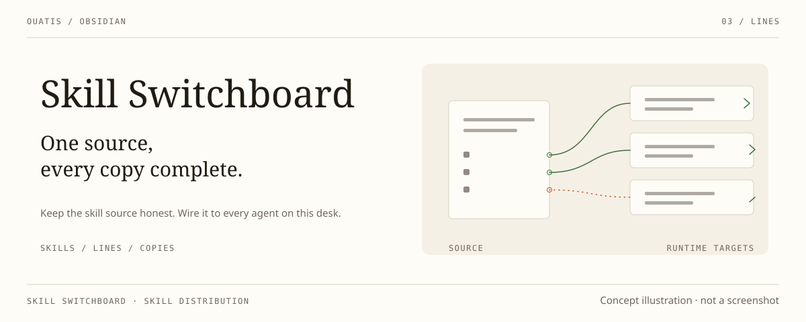

# Skill Switchboard · 技能接线台

_在 Obsidian 维护技能，向本机 Agent 分发完整副本。_

[English](./README.md)

  
  
  

技能接线台是一款 Obsidian 桌面插件。在同步库中维护一份权威技能源，由已有的库同步方案带到其他电脑；接线台在各机检查并分发完整技能包。插件不另建云同步服务，不联网，也不收集遥测。读写只发生在你配置的目录内——库内技能源、各 Agent 目标目录、插件目录（快照），以及库根目录（状态文件）；不触碰磁盘上的其他任何位置。

从功能区图标或「打开技能接线台」命令打开视图，可停靠在主区域或侧栏；来源、目标、自动分发和快照恢复都在「设置 → 第三方插件 → Skill Switchboard」中。界面沿用与 Desk Lamp、Scriptorium、Collate（比稿）协调的安静面板和细线，跟随 Obsidian 主题，提供英文和简体中文。

## 安装

已上架社区插件商店：开启第三方插件后，**设置 → 第三方插件 → 浏览**，搜「Skill Switchboard」即可。需要桌面端 Obsidian 1.7.2 或更新版本。

也可以手动安装：从[发布页面](https://github.com/ouatis/obsidian-skill-switchboard/releases)下载 `main.js`、`manifest.json` 和 `styles.css`，放入 `<vault>/.obsidian/plugins/skill-switchboard/`，再启用插件。

## 一份源，完整安装

1. 在库中选择一个可见技能源目录，通常为 `skills/`。每个标准技能是包含 `SKILL.md` 的目录，文件中有 `name`、`description`，并附带所需参考、脚本和资源。无需手写分发清单。
2. 用已有方案同步库，在每台电脑的「分发来源」中选择这个目录。
3. 在「运行时目标」添加本机 Agent。诸如 `~/.codex/skills` 的路径按本机用户解析。目标必须在库外，且不得与技能源重叠。
4. 运行「检查技能」，再「一键修复」。一次确认后安装缺失的技能包、按权威源覆盖所有不同副本。检查始终只读；后台写入需要下方独立的本机授权。

安装后的 `SKILL.md` 直接包含技能正文，不再是让模型转读另一份规则的薄入口。必要文件随包复制；保留各 Agent 必需的格式适配。标准技能包已有的 `agents/openai.yaml` 保持原样。

支持 Codex、Hermes、WorkBuddy、OpenCode、Antigravity，以及当前支持目录技能包的 DSH。复制文件不会安装 Agent、依赖或命令，不会改变其权限，也不能证明某个正在运行的会话已加载技能。

## 权威源说了算

### 可选的自动分发

「自动分发」默认关闭。在设置中开启，并一次确认本机显示的来源和 Agent 目录后生效。授权只保存在本机的笔记库配置中，不随 Obsidian Sync 传播。更换来源、清单、已启用目标或实际解析路径会撤销授权，需要重新开启确认；目标根目录相互重叠时不能授权。

Obsidian 运行期间，后台检查会等待两秒安静窗口，再读取一次来源快照，确认一致后才分发。手动「检查技能」仍只读。缺失或不安全的资源会阻断对应技能，其他独立技能仍可更新。安静窗口用于降低同步中间态的风险，不证明其他电脑已同步完成或 Agent 已加载技能。

文件占用、权限拒绝等瞬时失败会短暂重试。同一持续故障在本次插件会话中只提醒一次，来源与目标状态不变时不再重试；需要主动重试时用「一键修复」。关闭 Obsidian、关闭自动分发、更换授权范围或卸载插件会取消排队任务，并在后续包替换前中止。自动分发同样遵守下方的按源覆盖与快照规则。

「分发计划」按 Agent 列出四种状态：未安装、待按源覆盖、与源一致、受阻。优先展开受阻原因，无需先翻原始日志。统计的是各 Agent 的副本数，不是去重后的源技能数。「一键修复」只需一次确认，列明全部安装、覆盖的名称与路径，以及将被退库的副本。

- 同名目标技能是来源的分发产物。本地修改、同名旧安装都按源覆盖，不合并，也不作为冲突保留。不再有额外接管流程或管理凭据数据库；直接比较完整包的文件内容与可执行属性。
- 替换目标技能包前，被替换的目录会复制到插件的 `snapshots/` 目录。每个技能保留最近 5 份快照；「恢复最近一次技能快照」在确认后把最新一份写回。快照失败会报告，但不阻断分发。
- Agent 的修改不会回写 Obsidian。不在来源清单中的其他技能不动；删除来源或目标也不会静默卸载旧副本。没有技能的来源不会显示检查成功。
- 新目录先在目标旁准备、验证。准备期间来源变化，或计划确定后目标再次变化，都会中止替换；替换失败时尝试还原旧目录。还原或清理失败会报告残留路径，不算修复成功。
- 无效来源、不可读文件、包内链接或资源失败会阻断相应技能；独立技能仍可分发，部分完成不会显示为全部成功。

## 旧来源与外部工具包

完整技能包是唯一安装形式。旧 `wrapper`、`symlink` 设置按完整复制配置载入；载入设置不会改写已安装技能。旧薄入口在同一次「一键修复」中随完整包一并替换。目标位置的链接会被拒绝，不跟随。DSH 旧 `<name>.md` 也在同次操作中随目录包安装而移除。

来源旁的 `skills-manifest.json` 仍可用于旧式 Markdown 卡片、Agent 选择及元数据配置；`shared_file` 可指向相对卡片或 `folder/SKILL.md`。旧卡片会分发完整正文和本地引用闭包，声明的 `package_path` 资源也会随包复制。插件不是任意 Markdown 解释器：缺失或越界的本地引用会阻断分发；正文中依赖特定库的约定、绝对路径仍需作者整理。手动指定的清单不存在时会报错，不会悄悄退回自动发现。

旧卡片里的相对 Markdown 文件链接和包内资源路径声明随包必需文件；作为工作上下文的库内笔记使用 Obsidian `[[内链]]`，保留在正文中，不复制到 Agent 技能目录。插件不校验这些上下文笔记，也不因此把依赖特定库的技能变成独立工具；必需资源缺失或越界时仍阻断分发。

声明 `package_id` 的外部工具包仍是明确的运行依赖，不会被复制进每个 Agent 目录或自动下载。每台电脑在 `~/.skill-switchboard/packages.json` 登记本机路径；可选的 schema-v1 资源清单检查文件哈希。库外工具和路径不随 Obsidian Sync 同步。

来源、目标和启用的 Agent 按本机笔记库保存在 `~/.skill-switchboard/vaults/<vault-id>/settings.json`。界面偏好可随 Obsidian 设置同步；旧接线配置就地迁移，新电脑单独配置。技能源和可选清单继续放在库中，不另建一套私有内容数据库。

- 技能从源里移除后，本插件当初装的副本会列在「来源已消失的副本」下。修复会先快照再删除，
  「恢复最近一次技能快照」即可取回。只有安装记录指向它、且目录内容与安装时记录的指纹一致，
  副本才会被退库：安装后被改过的副本只报告不删除，用户手写的目录从不进入候选。安装记录放在
  插件 `snapshots/` 目录里，与快照并列。
- 库根目录的隐藏文件 `.skill-switchboard-status.json` 记录本次安装的版本、构建 ID 和检查／修复输出，不代表其他电脑的健康状态。诊断文本可能包含本机路径，分享前请检查。

作者：[@ouatis](https://github.com/ouatis)。
