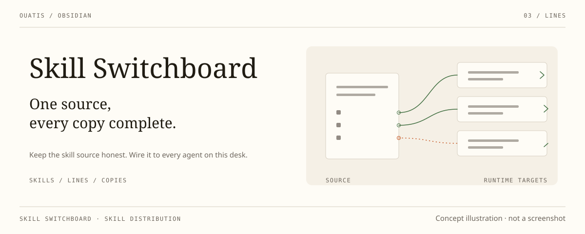

# Skill Switchboard · 技能接线台

_在 Obsidian 维护技能，向本机 Agent 分发完整副本。_

[English](./README.md)

  
  
  

技能接线台是一款 Obsidian 桌面插件。在同步库中维护一份权威技能源，由已有同步方案带到其他电脑；接线台在本机检查并分发完整技能包。插件不另建云服务、不联网、不收集遥测，所有读写仅限配置目录（库内技能源、Agent 目标目录、`<plugin>/snapshots/` 与库根目录 `.skill-switchboard-status.json`）。

从功能区图标或「打开技能接线台」命令打开视图（可停靠在主区域或侧栏）；设置位于「设置 → 第三方插件 → Skill Switchboard」。界面跟随 Obsidian 主题，提供英文与简体中文。

## 安装

社区插件商店：开启第三方插件后，在 **设置 → 第三方插件 → 浏览** 中搜索 **Skill Switchboard**（需要桌面端 Obsidian 1.7.2+）。

手动安装：从[发布页面](https://github.com/ouatis/obsidian-skill-switchboard/releases)下载 `main.js`、`manifest.json` 和 `styles.css`，放入 `<vault>/.obsidian/plugins/skill-switchboard/` 后启用。

## 快速上手

1. 在库内目录（通常为 `skills/`）放置标准 `<skill>/SKILL.md` 目录（包含 `name`、`description` 及所需 `references/`、`scripts/`、`assets/`），无需手写清单。若已有技能散落在本机 Agent 目录，可运行「从本机 Agent 导入技能」（或在设置、空库引导页点击「导入本机技能」），一次性复制进源目录，现有同名技能始终跳过。
2. 在每台电脑的「分发来源」中选定该目录。
3. 在「运行时目标」添加本机目标（或点击「探测已有目标」）。支持 Claude Code、Codex、Cursor、Gemini CLI、Hermes、WorkBuddy、OpenCode、Antigravity、当前目录式 DSH，以及「自定义（标准 `SKILL.md` 目录）」以适配 `~/.agents/skills` 或库外项目级目录（如 `~/code/my-app/.claude/skills`）。点击目标旁的「筛选技能」可在本机按目录筛选包含或排除的技能，无需手写清单。
4. 运行只读的「检查技能」（待覆盖副本支持展开预览变动文件清单与 `SKILL.md` 行级差异），确认后点击「一键修复」。

## 分发与安全规则

- **单向完整副本**：直接安装完整 `SKILL.md` 正文及所需本地文件（Codex 保留已有 `agents/openai.yaml`）。Agent 侧修改不回写 Obsidian，来源外技能不改动；复制文件不等于安装运行时依赖或证明会话已加载。
- **覆盖或退库前必先快照**：每次替换或删除前都会先快照到 `<plugin>/snapshots/`（每技能保留最近 5 份），可用「恢复最近一次技能快照」回写。
- **退库已移除技能**：技能从来源移除或被目标筛选排除后，「退库来源已消失的副本」（及已确认的「一键修复」）会先快照再清理安装账本记录且未改动的副本；被改过或手写的目录只报告不删除。
- **可选的自动分发**：默认关闭，按电脑单独授权；等待 2 秒安静窗口且两次快照一致才覆盖，永不自动退库，更换来源、清单、目标、解析路径或技能筛选后自动撤销授权。
- **原子替换与路径边界**：在目标旁暂存校验后再切换，失败时还原旧目录；目标必须位于库外且不与来源重叠；符号链接与缺失资源仅阻断对应技能，不掩盖部分失败。

## 进阶：清单、外部工具包与本机状态

- **可选 `skills-manifest.json`**：兼容旧式 Markdown 卡片（`shared_file`、相对引用闭包与 `package_path` 资源包）及适配器元数据；`[[wikilinks]]` 仅作库内上下文保留而不随包复制；显式指定的清单缺失时直接报错。
- **外部 `package_id` 工具包**：路径按电脑登记在 `~/.skill-switchboard/packages.json`，按可选 schema-v1 清单校验 SHA-256，不随包复制也不走 Obsidian Sync。
- **本机接线与状态文件**：来源、目标、筛选规则与自动授权保存在 `~/.skill-switchboard/vaults/<vault-id>/settings.json`（仅界面偏好跨机同步）；库根 `.skill-switchboard-status.json` 含本机诊断路径，分享前请检查。

作者：[@ouatis](https://github.com/ouatis)。
